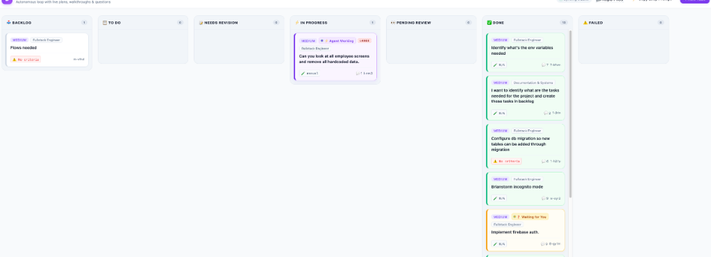
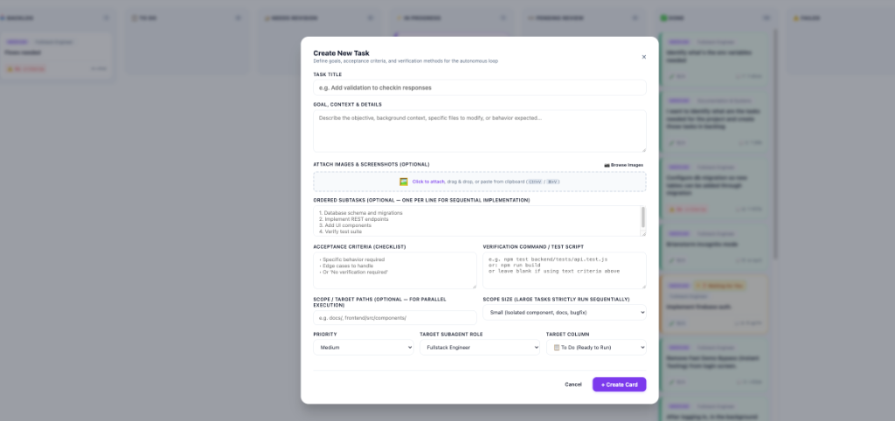
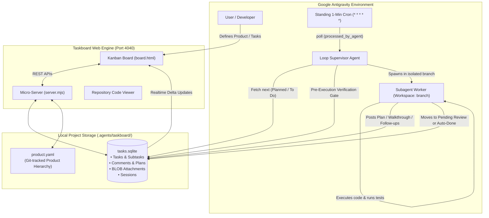

# 📋 Antigravity Taskboard Plugin

An autonomous engineering supervisor and Trello-style Kanban board plugin for **Google Antigravity**.

Provides continuous task loop orchestration with **project-scoped SQLite persistence** and a **version-controlled hierarchical product backlog (`product.yaml`)**—allowing you to track, schedule, parallelize, and verify subagents completely inside Antigravity without external daemons, cloud services, or third-party SDKs.

---

## 📸 Screenshots & UI Overview

### 1. Autonomous Kanban Taskboard
A live, responsive drag-and-drop board tracking subagent tasks across the entire engineering lifecycle: **Backlog**, **Planned**, **To Do**, **In Progress**, **👀 Pending Review**, **📝 Needs Revision**, and **✅ Done**. Cards feature real-time status badges (`⚡ Agent Working`, `❓ Waiting for You`, `⚠️ Permission`), subagent role tags, priority badges, subtask progress meters, verification criteria indicators, and parallel execution scope size pills (`SMALL`, `MEDIUM`, `LARGE`).



### 2. Structured Task Specification & Product Linkage Modal
Define actionable engineering tasks with pre-execution acceptance criteria checklists, automated verification test scripts, ordered subtasks for sequential execution, image/screenshot attachments (via clipboard paste or drag & drop), session assignments, parallel execution scope boundaries, and hierarchical product component linking.



---

## 🏗️ Architecture & Execution Flow



---

## ⚡ Core Features

### 1. File-Based Hierarchical Product Backlog (`product.yaml`)
* **Checked into Git**: The product backlog is stored in `product.yaml` at your project root, cleanly version-controlled alongside your code.
* **True Top-Down Hierarchy**: Organizes your product from project root $\to$ modules/epics $\to$ components/screens $\to$ features, sub-components, and improvements/bugs.
* **Interactive Backlog Drawer**: Browse and edit the backlog hierarchy directly inside the Taskboard UI with full drag-and-drop node reordering.
* **Live Git Status & Dirty Detection**: Real-time git status indicators show whether `product.yaml` has uncommitted changes with 1-click **Save / Commit** actions.
* **Universal 3-Option Component Actions**: When linking tasks or creating new backlog items, every component cleanly surfaces all 3 actions:
  - `✨ <Component> › features` (`+ Add Feature`)
  - `🧩 <Component> › components` (`+ Add Component`)
  - `💡 <Component> › improvements` (`+ Add Improvement`)
  Along with any existing features, components, or improvements already defined under that component.

### 2. Autonomous Mode (`autonomous_mode: true / false`)
* **Full Autonomy (Hands-Off)**: When Autonomous Mode is enabled (`autonomous_mode == true` or toggled on the board):
  - **No Pausing on Planned**: Once an implementation plan is formulated, the task advances immediately to `in_progress` and dispatches the subagent in the same turn without waiting for human approval.
  - **Auto-Approval upon Verification**: When verification tests pass and the walkthrough is posted, the card is automatically marked `done` and the loop advances to the next candidate task without stopping.
* **Human-in-the-Loop Mode (Supervised)**: When disabled:
  - Planned tasks hold in `planned` awaiting user review and click on `▶️ Proceed`.
  - Completed tasks hold in `👀 Pending Review` with structured walkthroughs and 3 suggested follow-up tasks awaiting developer testing and sign-off.

### 3. Pre-Execution Verification Gate (Mandatory)
* **Never Code on Assumptions**: Subagents are strictly blocked from writing code until verification criteria are confirmed.
* **3 Accepted Verification Methods**:
  1. **Automated Command**: e.g. `npm test`, `npm run build`, `pytest`, `cargo test`.
  2. **Textual Acceptance Criteria**: Explicit expectations describing behavior, UI states, or API contracts.
  3. **Explicit Exemption**: The task explicitly specifies `"no verification required"` or `"N/A"`.
* **Ambiguity Handling**: If criteria are missing or ambiguous, the agent halts, posts a `question` comment on the card, and transitions the card to review until clarified.

### 4. Scope-Aware Parallel Execution & File Conflict Gates
* **Large Scope Tasks**: Tasks with `scope_size: 'large'` (or touching fullstack architectures, root configs, or database schema migrations) execute strictly **one at a time** in complete isolation.
* **Parallel Execution for Small / Medium Tasks**: Disjoint small/medium tasks execute concurrently (up to a concurrency cap of 2) when automated scope analysis confirms zero overlapping file paths.
* **Pending Review File Locks**: Files modified by tasks sitting in `👀 Pending Review` remain locked until user sign-off, preventing race conditions and git merge conflicts.

### 5. Git Branch Isolation (`Workspace: "branch"`)
* All code tasks are dispatched to subagents in isolated git branches (`Workspace: "branch"`). Subagents work safely inside their sandbox branches, leaving your primary working tree clean and stable.

### 6. Ordered Sequential Subtasks
* Break down complex multi-file features into ordered subtasks (`order_index`).
* Subagents execute subtasks strictly sequentially: advancing the subtask to `in_progress`, verifying the subtask implementation against its individual command/criteria, and marking it `done` before moving to the next.

### 7. Interactive 3 Follow-Up Suggestions
* Upon successful implementation and verification, the subagent formulates **3 high-value follow-up tasks** (e.g. next logical feature increment, edge case/regression tests, performance hardening).
* These suggestions appear as interactive buttons directly inside the task walkthrough card on the Kanban board:
  - `➕ Create Task`: Instantly queues the suggested task into `To Do` with prefilled title, description, and criteria.
  - `✏️ Customize`: Opens the creation modal with the suggestion prefilled for fine-tuning.
  - `➕ Create Another Task`: Add custom follow-ups without leaving the review flow.

### 8. Multi-Session & Sprint Organization
* Group tasks by feature sprint, workstream, or milestone (`🎯 Active Session`).
* Filter the board by active session or view all tasks across the project.
* Start and stop sessions via the web UI or CLI.

### 9. Multi-Format SQLite Attachments (BLOBs up to 10MB)
* Attach screenshots, JSON fixtures, iOS Plist, XML, YAML, crash logs, and design assets.
* Upload via clipboard paste (<kbd>⌘+V</kbd> / <kbd>Ctrl+V</kbd>), drag & drop, or file picker.
* Stored directly inside SQLite BLOB tables—accessible to agents and downloadable with one click.

### 10. Web Audio Alerts & 5-Minute Reminder Loop
* Built-in Web Audio synthesis sounds an immediate chime whenever a card enters:
  - `👀 Pending Review`
  - `📋 Plan Created`
  - `❓ Question`
  - `⚠️ Permission Requested`
* Plays an initial 5-second chime, followed by 2-second periodic reminders every 5 minutes until acted upon. Automatically silences when the card is approved, replied to, or moved.

### 11. Native Repository Code & Markdown Viewer (`/repo/*`, `/docs/*`)
* Inspect code files and browse repository directories directly from task comments and attachments.
* Features syntax highlighting, line numbers, breadcrumbs, and live Markdown document rendering.

### 12. 5-Day Done Filter & Dedicated Archive (`/done`)
* Keeps the primary Kanban board light, fast, and focused by showing completed tasks from the last 5 days (`✅ Done (≤5d)`).
* Includes a dedicated Archive view at `/done` with instant search, category filters (Scope, Role, Priority, Date Completed), and 1-click task reopening.

### 13. Token-Efficient Delta Polling (`tasks.mjs poll`)
* The standing supervisor cron queries SQLite using read-receipt flags (`processed_by_agent`).
* Consumes only ~4 tokens per idle poll turn, preventing token waste during quiet periods.

### 14. 8-Hour Inactivity Auto-Termination
* Automatically terminates the supervisor loop after 8 continuous hours of inactivity (no active tasks, no pending todo items, and no unread comments) to conserve tokens and resources.

---

## 🗄️ Multi-Project Architecture

**Each project gets its own completely isolated SQLite database and product backlog.**

* **Project-Scoped by Default**: Resolves `process.cwd()` and stores data locally:
  ```text
  <PROJECT_ROOT>/.agents/taskboard/tasks.sqlite
  <PROJECT_ROOT>/product.yaml  (or .agents/taskboard/product.yaml)
  ```
* **Zero Cross-Contamination**:
  - `Project Alpha` has its own tasks, attachments, and product tree.
  - `Project Beta` runs its own board independently on port 4040.
* **Shared DB Override**: To point all projects to a single shared database, set `TASKBOARD_DB_PATH=/path/to/shared.sqlite`.

---

## 📦 Directory Structure

```text
antigravity-taskboard/
├── plugin.json                 # Antigravity Plugin Manifest
├── README.md                   # Comprehensive Plugin Documentation
├── package.json                # Server & CLI dependencies
├── product.yaml                # Example/self-tracking product backlog tree
├── assets/
│   └── screenshots/
│       ├── kanban-board.png    # Live Kanban board screenshot
│       └── create-task-modal.png # Task specification modal screenshot
├── rules/
│   └── AGENTS.md               # 13 Autonomous execution rules & safety gates
├── skills/
│   └── task-loop/
│       └── SKILL.md            # Autonomous supervisor loop skill
└── taskboard/                  # Taskboard Engine & Web UI
    ├── board.html              # Responsive Drag-and-Drop Kanban UI
    ├── server.mjs              # Standalone Node micro-server (Port 4040)
    ├── repo_viewer.mjs         # Repository file & code viewer
    └── tasks.mjs               # Black-box project-scoped SQLite CLI & API
```

---

## 🚀 Quick Start

### 1. Install Plugin
Clone into your project's `.agents/plugins` directory:
```bash
git clone https://github.com/svylabs/antigravity-taskboard.git .agents/plugins/antigravity-taskboard
```

### 2. Start the Taskboard Server
```bash
node .agents/plugins/antigravity-taskboard/taskboard/server.mjs
```
Open **`http://localhost:4040`** in your browser. The header automatically reflects your active project directory name.

### 3. Start the Autonomous Task Loop in Antigravity Chat
In your Antigravity conversation, simply say:
> *"Run the task loop"* or `/goal Run task loop`

The autonomous supervisor will:
1. Initialize the standing 1-minute recurring schedule (`* * * * *`).
2. Poll for new or planned tasks.
3. Formulate an implementation plan and verify acceptance criteria.
4. Dispatch subagents in isolated git branches (`Workspace: "branch"`).
5. Post walkthrough comments with verification proof and 3 follow-up suggestions.
6. Auto-approve (in Autonomous Mode) or wait for your review sign-off.

---

## 🤖 CLI Command Reference for Antigravity Agents

> ⛔ **Mandatory Agent Rule**: Treat `tasks.mjs` strictly as a **black-box executable CLI utility**. **NEVER call `read_file`, `view_file`, or `cat` on `tasks.mjs`.** All supported subcommands are documented below.

### 1. Autonomous Loop Orchestration & Delta Polling
```bash
# Poll for changes, unread comments, and pending tasks (~4 tokens when idle)
node taskboard/tasks.mjs poll

# Toggle or inspect Autonomous Mode
node taskboard/tasks.mjs autonomous status
node taskboard/tasks.mjs autonomous on
node taskboard/tasks.mjs autonomous off

# Fetch the next candidate task (checks 'planned' first, then 'todo')
node taskboard/tasks.mjs next

# List currently running active tasks
node taskboard/tasks.mjs active

# Reset the 8-hour inactivity timeout timer
node taskboard/tasks.mjs reset-idle
```

### 2. Task Lifecycle & Kanban Status
```bash
# Print ASCII Kanban board
node taskboard/tasks.mjs list

# Dump entire board state as JSON
node taskboard/tasks.mjs json

# Get complete details of a specific task (including subtasks, comments, attachments)
node taskboard/tasks.mjs get <TASK_ID>

# Create a new task in To Do
node taskboard/tasks.mjs add "<TITLE>" "[DESCRIPTION]" "[PRIORITY]" "[VERIFICATION_CMD]"

# Update task status (planned | in_progress | verification | done | failed)
node taskboard/tasks.mjs update <TASK_ID> in_progress
node taskboard/tasks.mjs update <TASK_ID> verification "Verification passed: tests 4/4 clean"
node taskboard/tasks.mjs update <TASK_ID> done "Verified and signed off"
node taskboard/tasks.mjs update <TASK_ID> failed "Compilation error in build"
```

### 3. Ordered Sequential Subtasks
```bash
# List all subtasks for a parent task ordered by order_index
node taskboard/tasks.mjs subtasks <TASK_ID>

# Fetch the next incomplete subtask
node taskboard/tasks.mjs next-subtask <TASK_ID>

# Add a subtask
node taskboard/tasks.mjs add-subtask <TASK_ID> "<TITLE>" [ORDER_INDEX] "[VERIFICATION_CMD]"

# Update subtask status (in_progress | done | failed)
node taskboard/tasks.mjs update-subtask <SUBTASK_ID> in_progress
node taskboard/tasks.mjs update-subtask <SUBTASK_ID> done
node taskboard/tasks.mjs update-subtask <SUBTASK_ID> failed
```

### 4. Structured Comments & Human Interaction
```bash
# Post a structured comment (plan | walkthrough | question | permission | comment)
node taskboard/tasks.mjs comment <TASK_ID> "### Implementation Plan..." "Supervisor" "plan"
node taskboard/tasks.mjs comment <TASK_ID> "### Walkthrough..." "Subagent" "walkthrough"
node taskboard/tasks.mjs comment <TASK_ID> "Which auth provider should we use?" "Subagent" "question"

# Retrieve all comments on a task
node taskboard/tasks.mjs comments <TASK_ID>

# Acknowledge an unread user comment (clears processed_by_agent flag)
node taskboard/tasks.mjs ack-comment <COMMENT_ID>

# Acknowledge task updates
node taskboard/tasks.mjs ack-task <TASK_ID>
```

### 5. Permission Alerts & Audio Chimes
```bash
# Post permission request alert and sound immediate system notification chime
node taskboard/tasks.mjs notify-permission [TASK_ID] "<PERMISSION_OR_TOOL_DETAILS>"

# Play notification chime (macOS system chime / terminal bell)
node taskboard/tasks.mjs beep
```

### 6. Follow-Up Task Suggestions
```bash
# List suggested follow-up tasks parsed from a task's walkthrough comment
node taskboard/tasks.mjs followups <TASK_ID>

# Automatically create one of the suggestions (index 1, 2, or 3) into To Do
node taskboard/tasks.mjs create-followup <TASK_ID> <INDEX>
```

### 7. Multi-Session Management
```bash
# Start a new active work session
node taskboard/tasks.mjs begin-session "<SESSION_NAME>" "[DESCRIPTION]"

# Stop the current or specified session
node taskboard/tasks.mjs stop-session [SESSION_ID]

# List currently active running sessions
node taskboard/tasks.mjs running-sessions

# List all historical sessions
node taskboard/tasks.mjs sessions
```

### 8. File & Attachment Management
```bash
# List all attachments associated with a task
node taskboard/tasks.mjs attachments <TASK_ID>

# Attach a local file (Images, JSON, Plist, XML, YAML, configs, logs) to a task
node taskboard/tasks.mjs add-attachment <TASK_ID> <FILE_PATH>

# Export / download a stored attachment to disk
node taskboard/tasks.mjs get-attachment <ATTACHMENT_ID> [OUTPUT_PATH]

# Delete an attachment
node taskboard/tasks.mjs delete-attachment <ATTACHMENT_ID>
```

---

## 🌐 Micro-Server REST API Reference

The embedded HTTP server running on `http://localhost:4040` exposes standard JSON endpoints:

| Endpoint | Method | Description |
| :--- | :--- | :--- |
| `/api/info` | `GET` | Project information, database paths, and active status |
| `/api/tasks` | `GET` | List all tasks with subtasks, comments, and attachments |
| `/api/tasks` | `POST` | Create a new task (supports `new_under:` backlog auto-creation) |
| `/api/tasks/:id` | `GET`, `PATCH`, `DELETE` | Retrieve, update status/fields, or delete a task |
| `/api/tasks/:id/comments` | `GET`, `POST` | Retrieve or add structured comments (`plan`, `walkthrough`, etc.) |
| `/api/tasks/:id/subtasks` | `GET`, `POST` | Retrieve or add ordered subtasks |
| `/api/tasks/:id/attachments`| `GET`, `POST` | List or upload file/image attachments |
| `/api/product` | `GET`, `POST` | Fetch or update the hierarchical product backlog tree (`product.yaml`) |
| `/api/product/status` | `GET` | Check git status and dirty changes of `product.yaml` |
| `/api/product/commit` | `POST` | Commit dirty `product.yaml` changes to git |
| `/api/product/nodes` | `POST` | Add a new component, feature, or improvement node |
| `/api/product/move` | `POST` | Reorder or move nodes within the backlog hierarchy |
| `/api/autonomous` | `GET`, `POST` | Inspect or toggle Autonomous Mode (`on` / `off`) |
| `/api/sessions` | `GET`, `POST` | List all sessions or create a new active session |
| `/repo/*`, `/docs/*` | `GET` | Web repository code browser and Markdown previewer |

---

## 🛡️ Autonomous Execution Safety Rules (`AGENTS.md`)

When executing tasks under the `antigravity-taskboard` plugin, all subagents and supervisor agents strictly adhere to the safety rules in [`rules/AGENTS.md`](rules/AGENTS.md):

1. **Pre-Execution Verification Gate**: Automated command, textual acceptance criteria, or explicit exemption confirmed before writing code.
2. **Scope-Aware Execution**: Strictly sequential for large/migration tasks; conflict-free parallel execution for small/medium tasks.
3. **Workspace Branch Isolation**: Always execute code tasks in isolated branches (`Workspace: "branch"`).
4. **Mandatory 3 Follow-Up Suggestions**: Formulate 3 actionable follow-up tasks directly in the board walkthrough comment.
5. **No Direct Reading of `tasks.mjs`**: Treat the CLI tool strictly as an executable black-box utility to avoid out-of-workspace security dialogs.
6. **Project-Scoped Storage**: Target local `.agents/taskboard/tasks.sqlite` and local `product.yaml`. Never touch other workspaces.
7. **Sequential Subtasks**: Child subtasks are executed strictly in order of `order_index`.
8. **Standing 1-Minute Cron (`* * * * *`)**: Maintains continuous supervision without polling loops or token waste.

---

## 📄 License

MIT License. Designed and crafted for the Google DeepMind Antigravity ecosystem.
